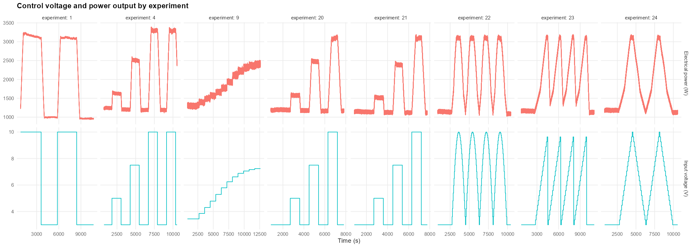
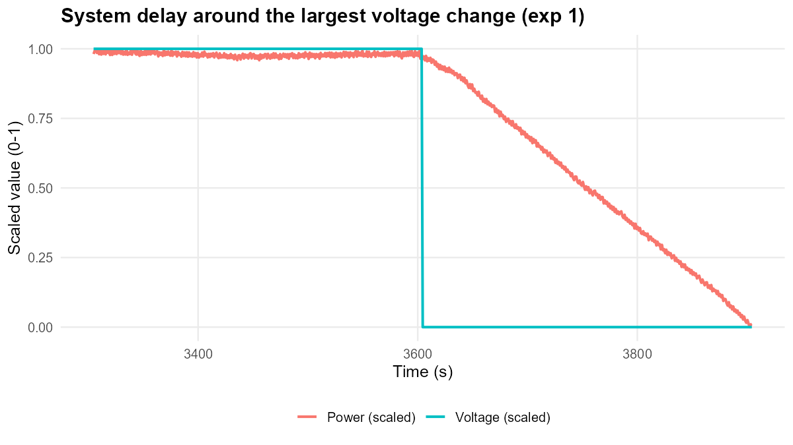
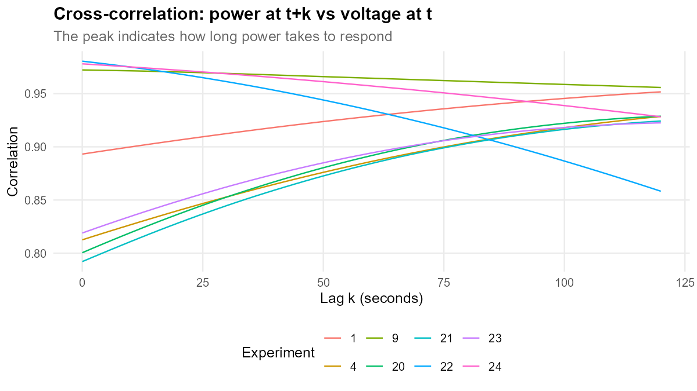
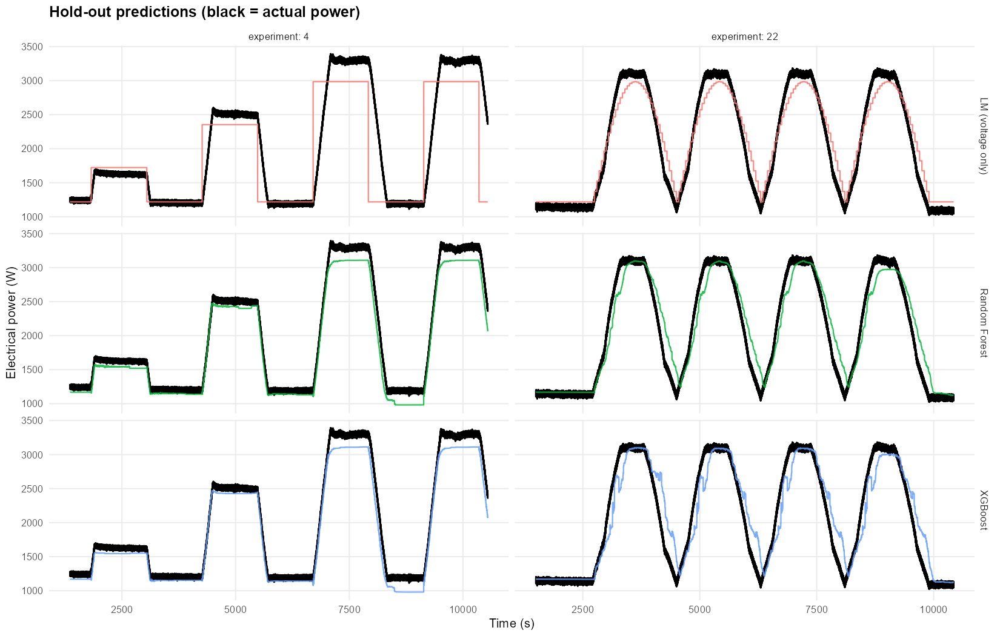
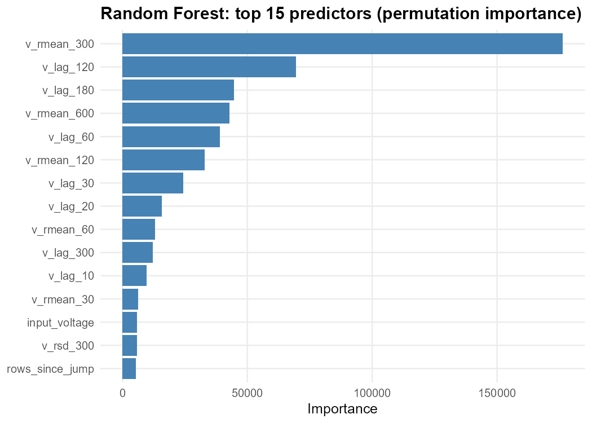

```{r setup, include=FALSE}
knitr::opts_chunk$set(echo = FALSE, warning = FALSE, message = FALSE,
                      fig.align = "center", out.width = "92%")

library(tidyverse)
library(kableExtra)

# Required pipeline outputs checked before reading/rendering results
# (Running the full pipeline on a fresh copy can take 10-20 minutes.)
required_outputs <- c("all_experiments.rds", "features_data.rds",
                      "train_data.rds", "cv_folds.rds",
                      "tbl_eda_summary.csv", "tbl_cv_results.csv",
                      "tbl_cv_by_experiment.csv", "tbl_best_params.rds",
                      "tbl_final_results.csv", "tbl_final_by_experiment.csv",
                      "fig_01_time_series.png", "fig_03_delay_zoom.png",
                      "fig_04_cross_correlation.png",
                      "fig_05_holdout_predictions.png",
                      "fig_06_variable_importance.png")

if (!all(file.exists(required_outputs))) {
  source("gas_turbine_analysis.R", local = knitr::knit_global())
}

eda    <- read_csv("tbl_eda_summary.csv",        show_col_types = FALSE)
cv_sum <- read_csv("tbl_cv_results.csv",         show_col_types = FALSE)
cv_exp <- read_csv("tbl_cv_by_experiment.csv",   show_col_types = FALSE)
final  <- read_csv("tbl_final_results.csv",      show_col_types = FALSE)
fin_ex <- read_csv("tbl_final_by_experiment.csv", show_col_types = FALSE)
best   <- readRDS("tbl_best_params.rds")

# Small helpers for inline numbers
val <- function(df, m, col) df[[col]][df$model == m]
f0  <- function(x) format(round(x), big.mark = ",")
pct <- function(x) paste0(round(100 * x), "%")

base_pooled <- val(final, "LM (voltage only)", "RMSE_pooled")
rf_pooled   <- val(final, "Random Forest",     "RMSE_pooled")
base_4      <- val(final, "LM (voltage only)", "RMSE_exp_4")
rf_4        <- val(final, "Random Forest",     "RMSE_exp_4")
xgb_4       <- val(final, "XGBoost",           "RMSE_exp_4")
base_22     <- val(final, "LM (voltage only)", "RMSE_exp_22")
rf_22       <- val(final, "Random Forest",     "RMSE_exp_22")
rf_cv       <- val(final, "Random Forest",     "RMSE_cv")

```

\newpage

# Introduction

## Overview

A micro gas turbine converts a control signal (an input voltage) into electrical power, but the response is not instantaneous. When the voltage changes abruptly, the power output follows with a long delay and moves toward its new level as a slow ramp. A model that only sees the current voltage therefore cannot predict the power well. A model that also sees the recent history of the voltage can.

This project uses machine learning to predict the electrical output power of a 3 kW commercial micro gas turbine. The goal is to **predict the electrical power (`el_power`, in watts) from the control voltage (`input_voltage`) and its recent history, comparing non-linear models against linear baselines, and evaluating them with the root mean squared error (RMSE) on experiments never seen during development.**

The guiding question is: *how much does the voltage history improve the prediction, and which model has the lowest RMSE on unseen experiments?*

## Dataset

The data come from the *Micro Gas Turbine Electrical Energy Prediction* dataset (UCI Machine Learning Repository, 2024), introduced by Bielski et al. (2024). It contains eight independent experiments recorded at roughly one observation per second, with no missing values. Each experiment is a time series with three variables:

| Variable | Role | Description |
| --- | --- | --- |
| `time` | Identifier | Time in seconds |
| `input_voltage` | Feature | Input control voltage (V) |
| `el_power` | Target | Electrical output power (W) |

There are two kinds of experiments. In *rectangular* series the voltage jumps instantly and the power follows with a visible delay. In *continuous* series the voltage changes gradually and the delay is barely visible. The dataset is downloaded and extracted automatically from the UCI repository by `gas_turbine_analysis.R`, so no manual download is required.

```{r exp-table}
type_lab <- c(`1` = "Rectangular", `4` = "Rectangular", `20` = "Rectangular",
              `21` = "Rectangular", `23` = "Rectangular*", `9` = "Continuous",
              `22` = "Continuous", `24` = "Continuous")

eda %>%
  mutate(Type = type_lab[as.character(experiment)],
         Role = if_else(split == "holdout", "Hold-out", "Training")) %>%
  select(Experiment = experiment, Role, Type, Rows = n_rows,
         `Hours` = duration_h, `Voltage changes` = voltage_n_chg,
         `Max jump (V)` = voltage_max_jump, `Mean power (W)` = power_mean) %>%
  mutate(across(c(Hours, `Max jump (V)`, `Mean power (W)`), ~ round(.x, 2))) %>%
  kable(format.args = list(big.mark = ","), booktabs = TRUE,
        caption = "The eight experiments. (*) Experiment 23 has many small changes plus large steps; it behaves like a rectangular series.") %>%
  kable_styling(latex_options = c("hold_position", "scale_down"), font_size = 9)

```

**Data split.** We follow the split used in the original paper: experiments 1, 9, 20, 21, 23 and 24 for development, and experiments 4 and 22 as the final hold-out. The hold-out contains one rectangular (4) and one continuous (22) series. The roles are assigned by experiment number in `gas_turbine_analysis.R`.

## Key steps

1. Load and validate the eight experiments.
2. Explore the data and measure the delay of the system.
3. Build features from the voltage history (lags, rolling statistics, jump features).
4. Validate with leave-one-experiment-out cross-validation.
5. Train and compare four models: two linear baselines, Random Forest and XGBoost.
6. Evaluate the final models once on the hold-out experiments.

# Methods

## Data loading and cleaning

The eight files were combined into one table with two added columns: `experiment` and `split` (training or hold-out). The checks showed no missing values and a total of 71,225 rows, as documented by the dataset. The sampling interval is about 1 second in experiments 1, 4 and 9, but slightly irregular in experiments 20 to 24 (median about 1.06 s, gaps up to about 4 s). For this reason, all lags and windows in this report are counted in **rows**, not in exact seconds.

## Exploratory analysis

Figure 1 shows the voltage and the power for every experiment. Rectangular series (1, 4, 20, 21) show a few large voltage steps, while continuous series (9, 22, 24) show smooth, repeated changes.

```{r fig1, fig.cap="Control voltage (top) and electrical power (bottom) for the eight experiments."}


```

Figure 2 zooms into the largest voltage change of experiment 1. The voltage drops instantly, but the power takes roughly 300 seconds to reach its new level, falling almost linearly. This delay is the central difficulty of the problem and means that the model needs a long memory of the voltage.

```{r fig2, fig.cap="System delay around the largest voltage change in experiment 1 (both series scaled to 0-1).", out.width="80%"}


```

Figure 3 shows the cross-correlation between the voltage at time *t* and the power at time *t + k*. In the rectangular series (1, 4, 20, 21, 23) the correlation keeps rising with the lag, so the power responds slowly. In the continuous series (9, 22, 24) it is highest at lag 0, so there is almost no delay. The maximum lag was limited to 120 rows, so the peaks for rectangular series are not observed; this plot confirms the two regimes but is not used to choose exact lags.

```{r fig3, fig.cap="Cross-correlation between voltage at t and power at t + k.", out.width="80%"}


```

**Insight.** A model using only the current voltage should work for continuous series but fail on rectangular ones. The experiments will test this expectation.

## Feature engineering

All features use only past voltage values, so there is no information leakage from the future, and they are computed separately inside each experiment. This prevents the end of one series from leaking into the start of another. The final data set has 29 predictors:

| Group | Features | Count |
| --- | --- | --- |
| Current voltage and change | `input_voltage`, `v_diff_1` | 2 |
| Lags (rows back) | 1, 2, 5, 10, 20, 30, 60, 120, 180, 300, 450, 600 | 12 |
| Rolling mean (trailing window) | 10, 30, 60, 120, 300, 600 | 6 |
| Rolling standard deviation | 10, 30, 60, 120, 300, 600 | 6 |
| Jump features (change above 1 V) | rows since last jump, voltage before jump, jump size | 3 |

The longest lag is 600 rows, chosen because the delay in Figure 2 is about 300 seconds. The first 600 rows of each experiment have incomplete features and were removed (5% to 9% of each series). The same rule applies to the hold-out, so the hold-out RMSE is computed on the remaining rows.

## Validation strategy

Rows in a time series are strongly correlated, so a random split would leak information between training and validation. Instead we use **leave-one-experiment-out cross-validation** on the six training experiments: each fold validates on one complete experiment and trains on the other five. Experiments 4 and 22 are never used for training, tuning or model selection. They are used once, at the end.

## Models

| Model | Predictors | Purpose |
| --- | --- | --- |
| Linear regression (voltage only) | `input_voltage` | Baseline: no history |
| Linear regression (all features) | 29 predictors | Baseline: linear use of history |
| Random Forest (`ranger`) | 29 predictors | Non-linear model 1 |
| XGBoost (`xgboost`) | 29 predictors | Non-linear model 2 |

Each non-linear model was tuned over a small grid, selecting the setting with the lowest mean cross-validation RMSE. Random Forest used 300 trees during tuning (`mtry` in {10, 20}, `min.node.size` in {5, 50}) and XGBoost used 300 rounds (`max_depth` in {4, 6}, `eta` in {0.05, 0.1}). The selected settings were mtry = `r best$rf$mtry` and min.node.size = `r best$rf$min.node.size` for Random Forest (final model with 500 trees), and max_depth = `r best$xgb$max_depth`, eta = `r best$xgb$eta` and nrounds = `r best$xgb$nrounds` for XGBoost. The final models were retrained on all six training experiments.

The main metric is the RMSE, defined as

$$\text{RMSE} = \sqrt{\frac{1}{n}\sum_{i=1}^{n}(y_i - \hat{y}_i)^2},$$

with the mean absolute error (MAE) and $R^2$ as complementary metrics.

# Results

## Cross-validation

Table 3 summarizes the cross-validation results. Table 4 breaks the RMSE down by validation experiment.

```{r cv-table}
cv_sum %>%
  select(Model = model, `RMSE (mean)` = RMSE_mean,
         `RMSE (rectangular)` = RMSE_rectangular,
         `RMSE (continuous)` = RMSE_continuous,
         `MAE (mean)` = MAE_mean, `R2 (mean)` = R2_mean) %>%
  mutate(across(where(is.numeric), ~ round(.x, 2))) %>%
  kable(booktabs = TRUE,
        caption = "Leave-one-experiment-out cross-validation (training experiments only). RMSE and MAE in watts.") %>%
  kable_styling(latex_options = c("hold_position", "scale_down"), font_size = 9)

```

```{r cv-exp-table}
cv_exp %>%
  select(model, experiment, RMSE) %>%
  mutate(RMSE = round(RMSE, 1)) %>%
  pivot_wider(names_from = experiment, values_from = RMSE,
              names_prefix = "Exp. ") %>%
  rename(Model = model) %>%
  kable(booktabs = TRUE,
        caption = "Cross-validation RMSE (W) by validation experiment. Experiments 9 and 24 are continuous; the rest are rectangular.") %>%
  kable_styling(latex_options = c("hold_position", "scale_down"), font_size = 9)

```

Random Forest has the lowest mean RMSE, and both non-linear models improve strongly on the rectangular experiments. On the two continuous experiments, however, the voltage-only baseline is better than the models that use history.

## Hold-out evaluation

Table 5 shows the final results on experiments 4 and 22, which were evaluated once with the final models. The pooled RMSE is computed over all hold-out rows; the last column repeats the cross-validation RMSE for reference.

```{r final-table}
final %>%
  select(Model = model, `RMSE pooled` = RMSE_pooled, `MAE pooled` = MAE_pooled,
         `R2 pooled` = R2_pooled, `RMSE exp. 4 (rect.)` = RMSE_exp_4,
         `RMSE exp. 22 (cont.)` = RMSE_exp_22, `RMSE (CV)` = RMSE_cv) %>%
  mutate(across(where(is.numeric), ~ round(.x, 2))) %>%
  kable(booktabs = TRUE,
        caption = "Final hold-out results (experiments 4 and 22). RMSE and MAE in watts.") %>%
  kable_styling(latex_options = c("hold_position", "scale_down"), font_size = 9)

```

Main findings:

* **Random Forest is the best model overall**, with a pooled RMSE of `r f0(rf_pooled)` W against `r f0(base_pooled)` W for the voltage-only baseline, a reduction of `r pct(1 - rf_pooled / base_pooled)`.
* **On the rectangular experiment (4), history is decisive.** The RMSE falls from `r f0(base_4)` W to `r f0(min(rf_4, xgb_4))` W (a reduction of `r pct(1 - min(rf_4, xgb_4) / base_4)`). XGBoost (`r f0(xgb_4)` W) and Random Forest (`r f0(rf_4)` W) are practically tied; with only one rectangular hold-out series, this difference is not conclusive.
* **On the continuous experiment (22), the baseline wins.** The voltage-only model reaches `r f0(base_22)` W, better than Random Forest (`r f0(rf_22)` W). With almost no delay, the long history adds noise instead of signal.
* **The hold-out error is higher than the cross-validation error** (`r f0(rf_pooled)` W against `r f0(rf_cv)` W for Random Forest). The hold-out is harder, and tuning on the same cross-validation that is reported makes the cross-validation figure somewhat optimistic.

Figure 4 compares predictions with the real power on the hold-out.

```{r fig4, fig.cap="Hold-out predictions (black line is the real power).", out.width="100%"}


```

Two failure modes are visible:

1. **Experiment 4:** the tree models follow the ramps well but underestimate the highest power levels (about 3,100 W predicted against about 3,300 W real). A likely reason is that tree-based models cannot predict values beyond the range seen in training; we did not test this.
2. **Experiment 22:** Random Forest and XGBoost react late on the descending parts, and XGBoost is also noisier. This is consistent with the long rolling means carrying memory that is not needed when the system responds without delay.

## Variable importance

Figure 5 shows the permutation importance of the Random Forest, computed on the training data only.

```{r fig5, fig.cap="Random Forest: top 15 predictors by permutation importance.", out.width="75%"}


```

The most important variables are rolling means and lags between 60 and 600 rows, with the 300-row rolling mean far ahead of the rest. This agrees with the delay of about 300 seconds seen in Figure 2. The current voltage ranks low, so the **history matters more than the instantaneous value**. The jump features contribute little. Because lags and rolling means are correlated, permutation importance may understate individual variables.

# Conclusion

**Summary.** Using the voltage history greatly improves the prediction of the turbine power. Random Forest was the best overall model on unseen experiments, with a hold-out RMSE of `r f0(rf_pooled)` W against `r f0(base_pooled)` W for the voltage-only baseline (`r pct(1 - rf_pooled / base_pooled)` lower). The gain is concentrated in rectangular series, where the RMSE dropped by about `r pct(1 - min(rf_4, xgb_4) / base_4)`. No single model is best everywhere: on the continuous series, the simple baseline was better.

**Potential impact.** A data-driven model of the delay can support simulation, control and monitoring of small gas turbines without a detailed physical model, and the results suggest that the model should be adapted to the type of signal.

**Limitations.**

* The hold-out has only two series, so small differences between models are not conclusive and the pooled RMSE mixes two different scenarios.
* The hold-out is a single final test, so we could not adjust the model after seeing it; the failure modes above were therefore not corrected.
* Experiments 20 to 24 have irregular sampling, so lags are measured in rows, not seconds.
* Hyperparameters were selected with the same cross-validation that is reported, which is slightly optimistic, and the grids were small.
* The first 600 rows of every series are discarded because of the long lags.
* Only one input variable is available, so all information comes from the voltage history.

**Future work.** (1) A model that selects its features by signal type, using few features for continuous series and long history for rectangular ones, decided with cross-validation only. (2) Sequence models such as LSTM or GRU networks. (3) Models that can extrapolate to higher power levels, such as a linear model on top of the trees. (4) Time-aware resampling that corrects the irregular sampling.

# References

* Bielski, P., Eismont, A., Bach, J., Leiser, F., Kottonau, D., and Böhm, K. (2024). *Knowledge-Guided Learning of Temporal Dynamics and its Application to Gas Turbines.* Proceedings of the 15th ACM International Conference on Future Energy Systems (e-Energy '24), Singapore.
* UCI Machine Learning Repository (2024). *Micro Gas Turbine Electrical Energy Prediction* dataset. [https://archive.ics.uci.edu](https://archive.ics.uci.edu)
* Irizarry, R. A. (2024). Introduction to Data Science: Data Wrangling and Visualization with R (2nd ed.). CRC Press.
* Wright, M. N. and Ziegler, A. (2017). ranger: A fast implementation of random forests for high dimensional data in C++ and R. *Journal of Statistical Software*, 77(1), 1-17.
* Chen, T. and Guestrin, C. (2016). XGBoost: A scalable tree boosting system. *Proceedings of the 22nd ACM SIGKDD International Conference on Knowledge Discovery and Data Mining*, 785-794.
* Wickham, H. et al. (2019). Welcome to the tidyverse. *Journal of Open Source Software*, 4(43), 1686.
* Zeileis, A. and Grothendieck, G. (2005). zoo: S3 infrastructure for regular and irregular time series. *Journal of Statistical Software*, 14(6), 1-27.

# Appendix: reproducibility

The analysis is consolidated in `gas_turbine_analysis.R` in the project folder, which downloads and extracts the dataset from the UCI repository and runs the full pipeline in order (`setup`, `load`, `eda`, `features`, `cv_split`, `models`, `final_eval`). A fixed seed (`123`) is set in `gas_turbine_analysis.R`. The hold-out experiments are kept isolated from training and hyperparameter selection until final evaluation.

